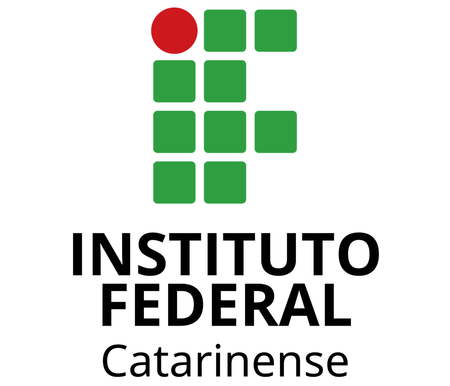

<p align="center">
  
</p>

# Vetores 3D

Visualizador interativo de vetores em três dimensões. Digite as coordenadas, veja as setas aparecerem no espaço e gire a cena para enxergar de qualquer ângulo.

Trabalho prático da disciplina de Álgebra Linear do curso de Ciência da Computação do **Instituto Federal Catarinense – Campus Concórdia**.

O projeto foi feito para a instituição: a ideia é que professores e estudantes do IFC possam usar a ferramenta em aula, como apoio para enxergar vetores, soma, subtração, produto vetorial e ângulo entre vetores, em vez de depender só do desenho no quadro.

## O que dá pra fazer

- Adicionar quantos vetores quiser, cada um com nome, cor e coordenadas (x, y, z)
- Editar os valores e ver a seta deslizar até a nova posição
- Arrastar a ponta da seta com o mouse para mover o vetor; com Shift, muda a altura (z)
- Girar (arrastar), aproximar (rolar) e voltar à vista inicial
- Escolher dois vetores e ver:
  - **Soma** — seta da origem até a + b
  - **Subtração** — seta da ponta de b até a ponta de a
  - **Produto vetorial** — a × b, perpendicular aos dois
  - **Paralelogramo** — as linhas tracejadas que fecham a figura
  - Módulo de cada um, produto escalar e o ângulo entre eles
- Exemplos prontos: os vetores da aula, a base canônica e vetores no plano

## Convenção dos eixos

Igual à usada em aula: **x** para a frente, **y** para a direita, **z** para cima.

## Como rodar

É um site estático, sem backend. Basta servir a pasta:

```bash
python3 -m http.server 8000
# abre http://localhost:8000
```

Ou abrir pelo GitHub Pages do repositório.

## Autores

| Nome | GitHub |
|------|--------|
| Vinicius Borsatti | [@ViniciusBorsatti](https://github.com/ViniciusBorsatti) |
| Lorenzo | — |
| Arthur | — |

Disciplina de Álgebra Linear · Ciência da Computação · IFC Campus Concórdia · 2026

## Tecnologias

- [Three.js](https://threejs.org/) para a cena 3D (incluído em `vendor/`, funciona offline)
- HTML, CSS e JavaScript puros, sem build
